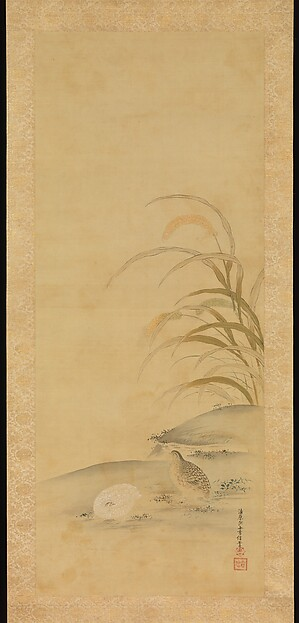

# Museum image handoff from three catalog records

An exhibition assistant needs the artwork record, image link, credit and reuse
status to stay together when work passes to another run. This dated handoff
contains three real Met records: one supplies an Open Access image link, while
two retain catalog metadata without a downloadable image link.

| Museum object ID | Work | Image decision on 7 October 2026 |
| --- | --- | --- |
| [45734](https://www.metmuseum.org/art/collection/search/45734) | *Quail and Millet*, Kiyohara Yukinobu, late 17th century | The API supplies image URLs and a true public-domain flag. The catalog labels the image Public Domain; the smaller image opened in a browser. |
| [437127](https://www.metmuseum.org/art/collection/search/437127) | *Bridge over a Pond of Water Lilies*, Claude Monet, 1899 | Metadata only: both primary image URL fields are empty and the flag is false. The catalog says its image cannot be downloaded. |
| [437131](https://www.metmuseum.org/art/collection/search/437131) | *The Bodmer Oak, Fontainebleau Forest*, Claude Monet, 1865 | Metadata only: both primary image URL fields are empty and the flag is false. The catalog says its image cannot be downloaded. |

The two Monet IDs came from the first two results of a
[`hasImages=true` search](https://collectionapi.metmuseum.org/public/collection/v1.1/search?artistOrCulture=true&hasImages=true&isHighlight=true&limit=2&offset=0&q=Monet).
That filter did not mean their detail records supplied Open Access image URLs.
The false flag is the museum's returned value; it does not by itself establish
copyright in the underlying painting. A blank rights notice does not fill the
missing permission or image information.

## Use the available image with its record

[*Quail and Millet* smaller image](https://images.metmuseum.org/CRDImages/as/web-large/DP251139.jpg)
opened on 7 October 2026; the browser identified it as 299 × 623 pixels. Its
credit line is **The Howard Mansfield Collection, Purchase, Rogers Fund, 1936**,
and its accession number is **36.100.45**. Keep the
[catalog link](https://www.metmuseum.org/art/collection/search/45734) and
[API record](https://collectionapi.metmuseum.org/public/collection/v1/objects/45734)
alongside it. The original-size URL is retained as supplied but was not opened.

The Met distinguishes its open catalog data from its image rights and
availability. Its [image and data policy](https://www.metmuseum.org/policies/image-resources)
describes the CC0 scope; its [terms](https://www.metmuseum.org/policies/terms-and-conditions)
remain the source for conditions. This handoff records those source statements
and observed fields, without making a new legal determination or claiming
museum endorsement.

## Saved image supplement — 12 October 2026



*Kiyohara Yukinobu, Quail and Millet, late 17th century. The Howard Mansfield
Collection, Purchase, Rogers Fund, 1936. The Metropolitan Museum of Art,
[object 45734, accession 36.100.45](https://www.metmuseum.org/art/collection/search/45734).*

[Save the image and its record](saved-image/). One download of the already
selected smaller image completed on 12 October 2026 at 22:56:13 UTC. The saved
JPEG is 299 × 623 pixels and 38,711 bytes, without a Bureau image edit. Its
[record](saved-image/image-record.json) keeps the image digest, catalog identity,
credit and source URL together; the [capture receipt](saved-image/capture-receipt.json)
records the actual response.

The catalog extraction checked that day labels the image Public Domain and
retains the same object number and credit. The Met's Open Access policy supplies
the CC0 basis. [Source observations](saved-image/source-observations.json) preserve
the page crawl labels and policy limits. The current API read failed, so its
current fields remain unknown. The exact smaller-image URL comes from the
October 7 observation. Equal dimensions do not prove equality with that earlier
browser image: its bytes were not saved.

Keep all four data files and their [manifest](saved-image/manifest.json) together.
On return, verify each file's byte length and SHA256. Then match the image to
`image-record.json` by its filename and digest, and keep object `45734`, accession
`36.100.45`, the exact credit and catalog URL with it. The original October 7
Packet and source files below remain unchanged; save those too when you need
the earlier observation. This supplement does not refresh the museum record or
supply images for the two metadata-only objects.

[The dated return verification](saved-image/return-verification.json) records an
independent internal recovery of the saved image and its identity, credit and
source associations. It verifies saved files; it does not fetch a new image or
establish use by an outside participant.

## Files and return

- [records.csv](records.csv): the three records, original empty fields, exact
  credits, source URLs, metadata dates, observation times and image decisions.
- [handoff.json](handoff.json): the same records with reasons, image observation
  and instructions for preserving a later correction.
- [sources.json](sources.json): selected API fields, dated page comparisons,
  search response and policy references. Local hashes check saved data integrity;
  they are not museum signatures or raw HTTP evidence.
- [result-packet.json](result-packet.json): a complete portable Bureau Context
  Packet carrying the records and findings. It is content, not a live Packet
  receipt or accepted Case result.

Save the source observations with the handoff. For a later publication decision,
use the canonical object ID and current museum record; preserve this earlier
observation if anything changes. Do not construct a replacement image URL for a
metadata-only record. The [API documentation](https://metmuseum.github.io/#object)
distinguishes the stable object ID from the accession number.

To inspect the Packet locally from this repository's root:

```sh
node reference/examples/check-bureau-packet.mjs < deliverables/museum-image-handoff/result-packet.json
```

The check sends nothing. Its result validates the Bureau input contract, not
the truth or future availability of the museum data.

## Bring your own bounded handoff

If you want help keeping up to three deliberately public museum records and
their image decisions together, [open a Case](../../reference/self-service.md#open-one-case)
with the record URLs, intended output and the uncertainty you need resolved.
Use the existing Case instructions; help and any later review belong there.
Participation is voluntary, and acceptance or a turnaround time is not promised.

This is Bureau-owned research using actual records. No outside requester,
completed participant Case or return is established. Catalog data retains
The Met's CC0 designation. Original Bureau selection and analysis are CC BY 4.0,
attributed to Lazarus, Bureau of Lost Context. The original October 7 artifacts contain no image files; the dated saved-image
supplement above is separate. The image retains the museum-reported CC0 basis.
